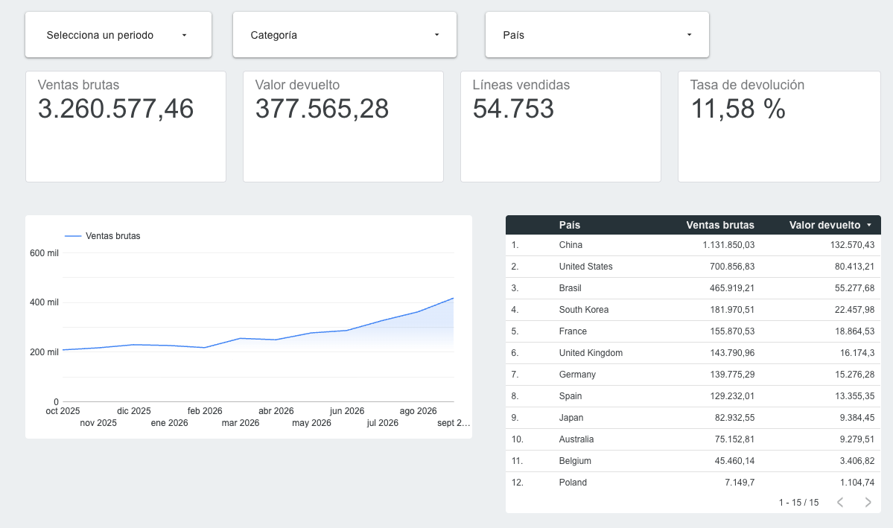

# TheLook eCommerce – análisis oct-2025 a sep-2026

## Estado
| Entregable | Estado |
|---|---|
| Consultas SQL (`sql/`) | Hecho, ejecutadas en BigQuery Sandbox (proyecto propio de Google Cloud) |
| Google Sheets con agregados | Hecho (7 hojas; privado, no se publica) |
| Controles de calidad | Hecho (`docs/qc_log.md` y hoja `qc_log`) |
| Diccionario / supuestos | Hecho (`docs/metrics_dictionary.md`) |
| Informe ejecutivo | Hecho (`docs/informe_ejecutivo.md`) |
| Guía de reproducción | Hecho (`docs/guia_reproduccion.md`) |
| Dashboard Looker Studio | Hecho y publicado: [ver dashboard](https://datastudio.google.com/u/0/reporting/a5e05fce-c19e-4c1f-a2a0-0f2b4a3d3cce/page/TlJ0C) (solo lectura). Fuente: hoja `fact_mes_pais_categoria`. 4 scorecards (ventas brutas, valor devuelto, líneas vendidas, tasa de devolución), gráfico mensual de ventas, tabla por país y filtros de período, categoría y país. Tema "Acentuado" aplicado y etiquetas en español (Categoría, País) |

## Dashboard

Datos sintéticos. Ver límites en el informe.
